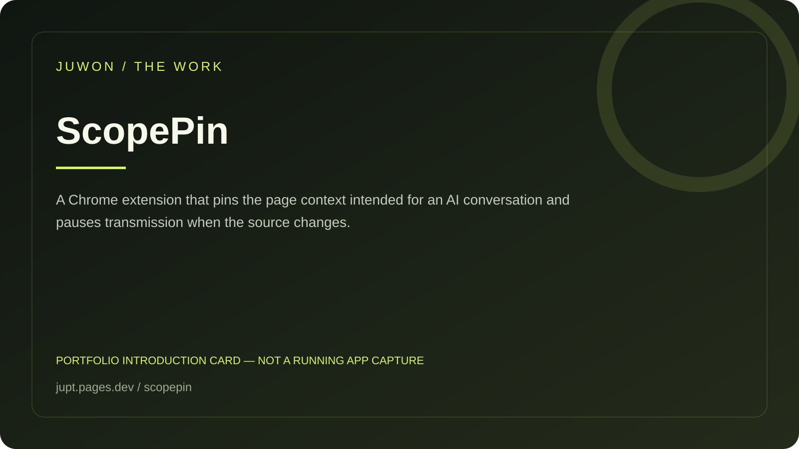

<!-- JUWON-PORTFOLIO-INTRO:START -->
# ScopePin



*Portfolio introduction card, not a screenshot of a running application.*

*포트폴리오 소개 카드입니다. 실행 화면 캡처가 아닙니다.*

## English

A Chrome extension that pins the page context intended for an AI conversation and pauses transmission when the source changes.

[View JUWON's portfolio](https://jupt.pages.dev/) · [Browse the project collection](https://jupt.pages.dev/projects)

**Scope:** This README presents the repository's documented intent and recorded visual evidence. It does not certify that every feature is complete, deployed, or currently working. Follow the original setup, safety, and license documentation below.

## 한국어

AI 대화에 사용할 페이지를 고정하고 출처가 바뀌면 전송을 멈추는 확장.

[JUWON 포트폴리오 보기](https://jupt.pages.dev/) · [전체 프로젝트 보기](https://jupt.pages.dev/projects)

**확인 범위:** 저장소의 문서상 목적과 기록된 화면 근거를 소개합니다. 모든 기능의 완성·배포·현재 정상 작동을 보증하지 않습니다. 설치법·안전 주의사항·라이선스는 아래 기존 문서를 확인하세요.
<!-- JUWON-PORTFOLIO-INTRO:END -->

---

## Original documentation / 기존 문서

# 📌 ScopePin

## Pin the page. See the scope. Stop stale sends.

ScopePin is a local-first Chrome extension for people who work across browser tabs and AI chats. It lets you explicitly pin one source page, shows that scope inside ChatGPT, Claude, Gemini, or Grok, and blocks common send actions when the pinned source has changed or closed.

The small but important idea: an AI answer can look plausible even after the context you meant to use has silently changed. ScopePin turns that hidden state into a visible, reviewable stop.

## Try it in two minutes

Requirements: Chrome/Chromium and Node.js 20+ for the local verification commands.

1. Download or clone this folder.
2. Run `npm ci` and `npm run verify`.
3. Open `chrome://extensions`, enable **Developer mode**, choose **Load unpacked**, and select `dist/scopepin-extension` after `npm run build`.
4. Open a source page, optionally highlight an excerpt, then click the ScopePin toolbar icon → **Pin this page**.
5. Open a supported AI chat. The green **ScopePin LIVE** banner shows the pinned source.
6. Navigate or close the source tab. The banner turns red and common Enter/send-button actions are blocked until you pin again.
7. Use **Copy capsule** to create a reviewable Markdown block. Pasting it into chat is always your choice.

## What it does — and does not do

- ✅ Stores one pinned scope in local extension storage.
- ✅ Removes URL fragments and limits selected text to 12,000 characters.
- ✅ Detects source-tab closure and source navigation.
- ✅ Shows a visible status banner in supported AI sites.
- ✅ Requires an explicit click to read the active page and selection.
- ✅ Includes no API key, account, telemetry, cloud service, or automatic prompt submission.
- ❌ It is not an OS sandbox and does not guarantee that a provider's DOM will stay unchanged.
- ❌ It does not silently inject text into a prompt or read arbitrary websites.

Supported hosts: `chatgpt.com`, `chat.openai.com`, `claude.ai`, `gemini.google.com`, and `grok.com`.

## Why this is worth testing

This is not a claim that ScopePin is already a category winner. It is a narrow experiment around a documented failure mode: developers report AI coding tools using the wrong session, file, or project context. See [VS Code issue #316051](https://github.com/microsoft/vscode/issues/316051), [Codex issue #34341](https://github.com/openai/codex/issues/34341), and [Copilot issue #13039](https://github.com/microsoft/vscode-copilot-release/issues/13039).

Existing browser bridges such as [OpenBrowser](https://github.com/1129Aliasgar/OpenBrowser) and [insidebar.ai](https://github.com/xiaolai/insidebar-ai) make it easier to reach multiple AI providers. ScopePin tests a different layer: whether a visible source pin and a hard stale-context stop prevent a bad send before it happens.

## Founder experiment

- **First user:** a developer who keeps a documentation tab, an issue tab, and an AI chat open at the same time.
- **First ten users:** people already using multi-tab AI workflows; invite them to load the unpacked extension and record one stale-source attempt. No outreach is automated by this repository.
- **User value:** fewer wrong-context prompts, less re-reading, and a clear reason to stop before sending.
- **Free-first cost:** CAD 0 for the MVP: local Chrome extension, no hosted service, no paid API.
- **Revenue hypothesis:** keep the individual extension free; later test paid team policies or audit exports only if users repeatedly ask for shared controls. This is unverified.
- **7-day experiment:** ten users perform the same source-navigate/send scenario; measure whether the banner is understood and whether anyone voluntarily keeps it installed.

### Facts vs hypotheses

**Confirmed in this repository:** the engine normalizes URLs, fingerprints bounded excerpts, detects stale source state, renders a capsule, and the extension bundle passes automated checks.

**Still hypotheses:** stale context is frequent enough to drive adoption, the five provider adapters cover the first users, the blocking behavior feels helpful rather than annoying, and teams would pay for shared policy/reporting.

## Security and privacy

ScopePin uses the narrow `activeTab`, `scripting`, and `storage` permissions. It has no `<all_urls>` permission, no network request code, and no cloud account. Read [SECURITY.md](SECURITY.md) before testing it with sensitive pages. Report security issues privately rather than opening a public issue.

## Development

```text
npm ci
npm test
npm run check
npm run build
npm run verify
npm audit --audit-level=high
```

See [CONTRIBUTING.md](CONTRIBUTING.md), [docs/design.md](docs/design.md), and the [verification capsule](docs/verification/release-capsule-v0.1.0.md).

## License

MIT. See [LICENSE](LICENSE).
